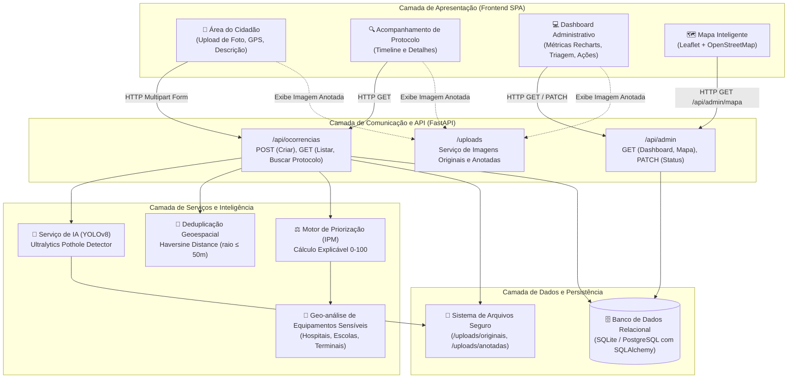

# ARQUITETURA DO SISTEMA — VIAALERTA

**Global Solution 2026.2 — FIAP Graduação ON em Inteligência Artificial**  
**Tema:** *CitizenTech — Tecnologia centrada no cidadão*

---

## 1. VISÃO GERAL ARQUITETURAL

O **ViaAlerta** adota uma arquitetura orientada a serviços desacoplados (Frontend SPA + Backend RESTful + Camada Especializada de Inferência de Visão Computacional + Banco Relacional), concebida para atender aos princípios de escalabilidade, modularidade, explicabilidade e segurança da informação.

---

## 2. COMPONENTES PRINCIPAIS

### 2.1. Frontend SPA (Single Page Application)
- **Framework:** React 18 com TypeScript, compilado via Vite.
- **Estilização:** Tailwind CSS responsivo (design escuro moderno e acessível, tipografia Inter e JetBrains Mono).
- **Cartografia:** Leaflet e OpenStreetMap integrado sem dependência de chaves pagas, fornecendo geolocalização precisa, cliques interativos e popups com evidências fotográficas.
- **Visualização de Dados:** Recharts para gráficos de barra e rosca da distribuição de severidade e ocorrências por bairro.

### 2.2. Backend RESTful
- **Framework:** FastAPI (Python 3.11), aproveitando suporte nativo a tipos tipados e validações via Pydantic v2.
- **ORM:** SQLAlchemy com padrões de isolamento transacional, lazy/eager loading e mapeamento relacional estrito.
- **Servidor ASGI:** Uvicorn com suporte assíncrono.
- **Tratamento de Arquivos:** Sanitização rigorosa de nomes, geração de identificadores UUIDv4, verificação de integridade via checksum SHA-256 e prevenção de Path Traversal.

### 2.3. Módulo de Inteligência Artificial e Visão Computacional
- **Motor:** Ultralytics YOLOv8 (Small) adaptado e validado sobre a base Pothole Detection (CC BY 4.0).
- **Entrada:** Imagens de vias públicas enviadas nos formatos JPEG, PNG ou WEBP.
- **Pré-processamento:** Normalização de canais, auto-orientação EXIF e redimensionamento 640x640 com padding de preservação de aspecto.
- **Processamento:** Inferência real com limiar de confiança $\tau = 0.25$.
- **Pós-processamento:**
  - Extração de coordenadas absolutas $[x_{\min}, y_{\min}, x_{\max}, y_{\max}]$.
  - Cálculo da área relativa ocupada:
    $$\text{Área Relativa (\%)} = \frac{\sum (x_{\max} - x_{\min})(y_{\max} - y_{\min})}{W \times H} \times 100$$
  - Renderização OpenCV de caixas delimitadoras vibrantes com rótulo e score de confiança.
  - Classificação visual explicável: *Severa*, *Moderada*, *Leve* ou *Sem Buraco Identificado*.

### 2.4. Motor de Priorização (Índice de Prioridade de Manutenção - IPM)
Combina quatro dimensões operacionais complementares:
1. **Gravidade Visual ($S_{\text{visual}}$):** Área relativa e quantidade de buracos detectados (peso 0.35).
2. **Reincidência Comunitária ($S_{\text{reincidência}}$):** Quantidade de chamados no mesmo raio de 150m (peso 0.25).
3. **Tempo de Espera ($S_{\text{tempo}}$):** Dias decorridos sem conclusão da manutenção (peso 0.20).
4. **Proximidade Sensível ($S_{\text{sensível}}$):** Proximidade de hospitais, escolas e terminais de transporte (peso 0.20).

---

## 3. DECISÕES ARQUITETURAIS E JUSTIFICATIVAS

| Decisão | Alternativa Rejeitada | Justificativa Técnica |
| :--- | :--- | :--- |
| **FastAPI + Python** | Node.js / Express | O ecossistema Python concentra as bibliotecas maduras de visão computacional (PyTorch, Ultralytics, OpenCV), eliminando pontes complexas entre linguagens. |
| **YOLOv8 Real** | Simulação / Regras Heurísticas | Atende ao requisito essencial da FIAP de aplicação real de Inteligência Artificial sem simulações artificiais. |
| **SQLite para Execução Local** | PostgreSQL exclusivamente | Permite execução imediata e reproduzível na máquina de avaliação do tutor sem necessidade de instalar servidores externos de banco, mantendo compatibilidade 100% com PostgreSQL via SQLAlchemy. |
| **Leaflet + OpenStreetMap** | Google Maps API | Open source, gratuito, dispensa credenciais privadas expostas no cliente e funciona perfeitamente sem limites de cota ou faturamento. |
