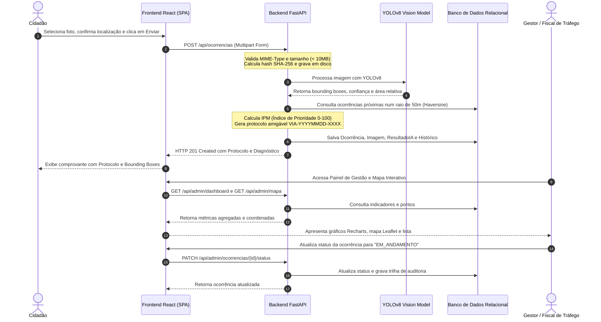

# DOCUMENTAÇÃO TÉCNICA COMPLETA — VIAALERTA

**Global Solution 2026.2 — Graduação ON em Inteligência Artificial**  
**Faculdade de Informática e Administração Paulista — FIAP**  
**Tema:** *CitizenTech — Tecnologia centrada no cidadão*

---

## 1. RESUMO EXECUTIVO

O **ViaAlerta** é uma solução de tecnologia cívica (*CitizenTech*) desenvolvida para enfrentar um dos maiores desafios cotidianos da mobilidade urbana: a proliferação desordenada de buracos e avarias estruturais na malha asfáltica.

A plataforma empodera o cidadão ao fornecer um canal direto, ágil e intuitivo para reportar buracos através do envio de fotografias e marcação geográfica. Diferente de ouvidorias tradicionais onde o registro fica dependente de triagem manual morosa, o ViaAlerta processa as imagens instantaneamente por meio de uma rede neural convolucional especializada em visão computacional (**YOLOv8**), detectando automaticamente a presença de buracos, delimitando suas caixas de contorno (*bounding boxes*), calculando a área visual relativa ocupada e aferindo a confiança probabilística da predição.

As ocorrências são armazenadas de forma estruturada em banco relacional e disponibilizadas em um **Dashboard Administrativo** e em um **Mapa Interativo (Leaflet/OpenStreetMap)**, apoiando equipes operacionais na triagem e no planejamento de manutenções preventivas e corretivas através do **Índice de Prioridade de Manutenção (IPM)** e da identificação automatizada de chamados reincidentes e duplicados.

---

## 2. PILARES TECNOLÓGICOS E DISCIPLINARES

A solução materializa a integração multidisciplinar das matérias do currículo de Inteligência Artificial da FIAP:

1. **Visão Computacional & Deep Learning:** Implementação e inferência do modelo YOLOv8 (*You Only Look Once* v8s) da Ultralytics treinado para a detecção de defeitos viários em tempo real.
2. **Engenharia de Software & Arquitetura Web:** API REST assíncrona desenvolvida com Python 3.11 e FastAPI, aplicando arquitetura em camadas desacopladas, schemas de validação Pydantic e ORM SQLAlchemy.
3. **Engenharia Front-end & UX:** Interface responsiva em React 18, TypeScript, Tailwind CSS e Leaflet, desenhada sob o conceito *Citizen-First* (mobile-first, baixo atrito no preenchimento, feedback imediato com protocolo legível).
4. **Ciência de Dados & Geoprocessamento:** Algoritmo de geodésia baseado na fórmula de **Haversine** para detecção de reincidências e duplicidades em raio de 50 metros, associado a um modelo matemático explicável para o IPM.
5. **Governança & Segurança da Informação:** Validação estrita de tipos MIME, limite de carga (10MB), prevenção de Path Traversal, anonimização pública e trilha auditável de auditoria de status com timestamps UTC.

---

## 3. FLUXO DE FUNCIONAMENTO INTEGRADO

---

## 4. O ÍNDICE DE PRIORIDADE DE MANUTENÇÃO (IPM)

O IPM é uma pontuação explicável e transparente de 0 a 100 pontos desenvolvida para orientar a ordem de atendimento das equipes de rua:

$$\text{IPM} = 0.35 \times S_{\text{visual}} + 0.25 \times S_{\text{reincidência}} + 0.20 \times S_{\text{tempo}} + 0.20 \times S_{\text{sensível}}$$

### Descrição dos Componentes:
- **$S_{\text{visual}}$ (Peso 35%):** Gravidade geométrica calculada sobre a área visual ocupada pelo buraco na foto. Se não houver buraco, atribui-se pontuação mínima (10 pts).
- **$S_{\text{reincidência}}$ (Peso 25%):** Contabiliza o número de ocorrências abertas num raio de 150 metros. Quanto mais cidadãos reportarem problemas no mesmo trecho da rua, maior a pontuação de reincidência da via.
- **$S_{\text{tempo}}$ (Peso 20%):** Pontuação proporcional aos dias de espera sem conclusão do reparo (adiciona 4 pontos por dia até teto de 100).
- **$S_{\text{sensível}}$ (Peso 20%):** Proximidade de equipamentos públicos de alta vulnerabilidade (hospitais, escolas, creches, terminais de ônibus e metrô). Raio $\le 150\text{m}$ atribui nota 100.

---

## 5. RECONHECIMENTO DE DUPLICIDADES GEOESPACIAIS

Para evitar poluição de dados e sobrecarga da equipe técnica:
- Toda nova ocorrência tem suas coordenadas $(lat_1, lon_1)$ comparadas com as coordenadas $(lat_2, lon_2)$ das ocorrências ativas ou abertas nos últimos 30 dias via fórmula de Haversine:
  $$d = 2R \arcsin\left(\sqrt{\sin^2\left(\frac{\Delta\phi}{2}\right) + \cos\phi_1\cos\phi_2\sin^2\left(\frac{\Delta\lambda}{2}\right)}\right)$$
- Se $d \le 50\text{ metros}$ e $\Delta t \le 30\text{ dias}$:
  - O sistema marca `possivel_duplicidade = True` e vincula o `ocorrencia_referencia_id` à ocorrência mais antiga.
  - O registro **nunca é excluído automaticamente**, garantindo que nenhum cidadão fique sem comprovante e que a demanda comunitária seja computada na reincidência.
