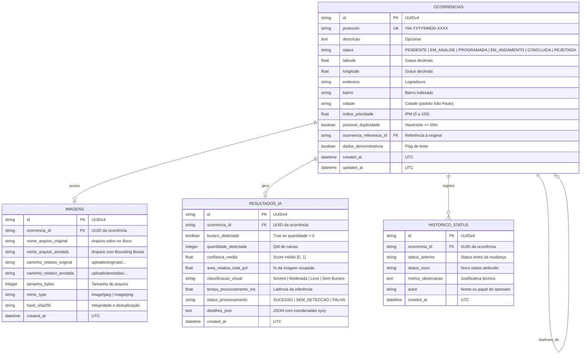

# MODELAGEM DO BANCO DE DADOS — VIAALERTA

A modelagem do banco de dados do **ViaAlerta** prioriza a integridade referencial, rastreabilidade temporal e a minimização da coleta de dados pessoais, em total conformidade com a Lei Geral de Proteção de Dados (LGPD).

---

## 1. DIAGRAMA ENTIDADE-RELACIONAMENTO (MERMAID)

---

## 2. DICIONÁRIO DE DADOS DETALHADO

### Tabela: `ocorrencias`
Centraliza a entidade raiz de cada solicitação cadastrada pelo cidadão.
- `id`: Chave primária em UUIDv4 (36 caracteres), imutável.
- `protocolo`: Identificador único voltado ao cidadão no formato padronizado `VIA-YYYYMMDD-XXXX`.
- `latitude` e `longitude`: Ponto geoespacial com precisão de 6 casas decimais.
- `indice_prioridade`: Valor computado pelo algoritmo de apoio à decisão (IPM), normalizado de 0 a 100.
- `possivel_duplicidade`: Sinalizador booleano computado via fórmula de Haversine em raio $\le 50$ metros.
- `dados_demonstrativos`: Sinalizador obrigatório pela FIAP para distinguir registros de teste de dados de homologação.

### Tabela: `imagens`
Armazena as referências seguras aos arquivos físicos armazenados em disco.
- Nunca armazena o binário da imagem como BLOB dentro do banco, prevenindo degradação de performance relacional.
- `hash_sha256`: Permite auditoria forense de integridade da evidência fotográfica.

### Tabela: `resultados_ia`
Registra a inferência gerada pelo modelo YOLOv8.
- `buraco_detectado`: Booleano determinístico que indica se houve ao menos uma detecção acima do limiar $\tau = 0.25$.
- `area_relativa_total_pct`: Percentual da área total da foto ocupado pelas caixas delimitadoras, base da severidade visual.
- `detalhes_json`: Preserva o vetor completo de caixas delimitadoras com coordenadas $[x_{\min}, y_{\min}, x_{\max}, y_{\max}]$.

### Tabela: `historico_status`
Garante rastreabilidade total (trilha de auditoria) de todas as transições de status da ocorrência, registrando data, autor e justificativa.
